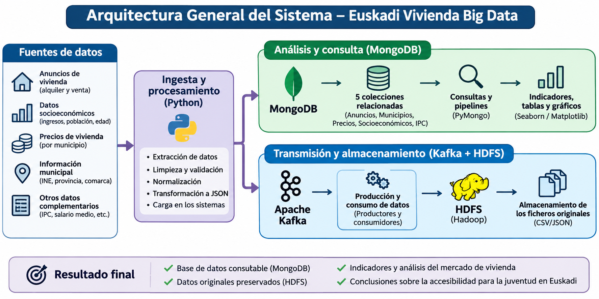
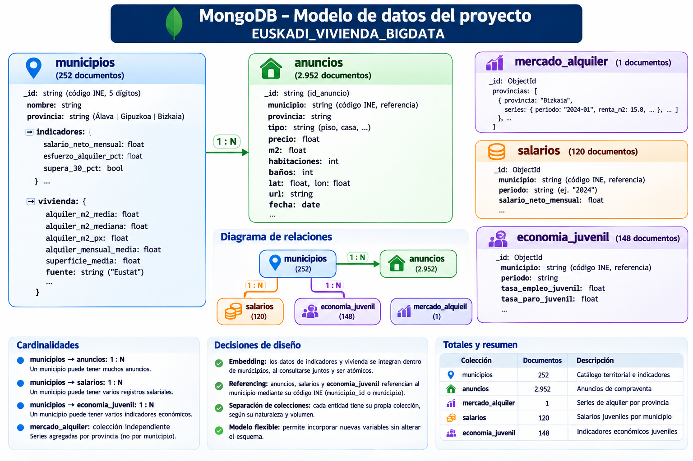
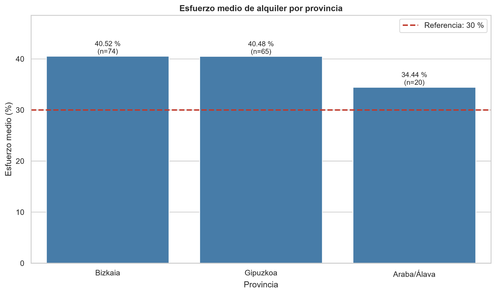
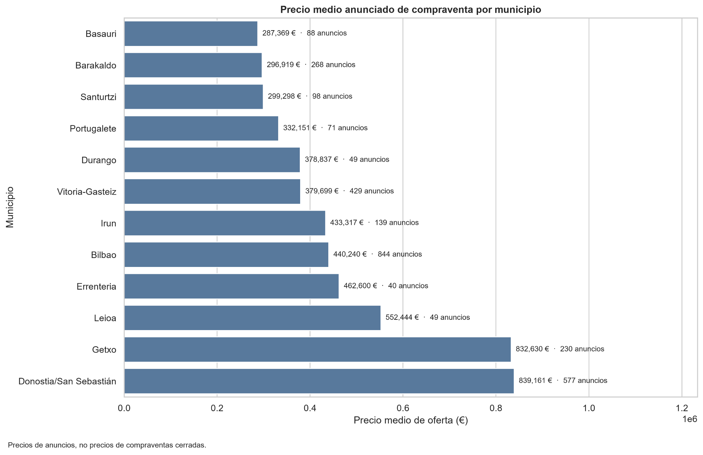
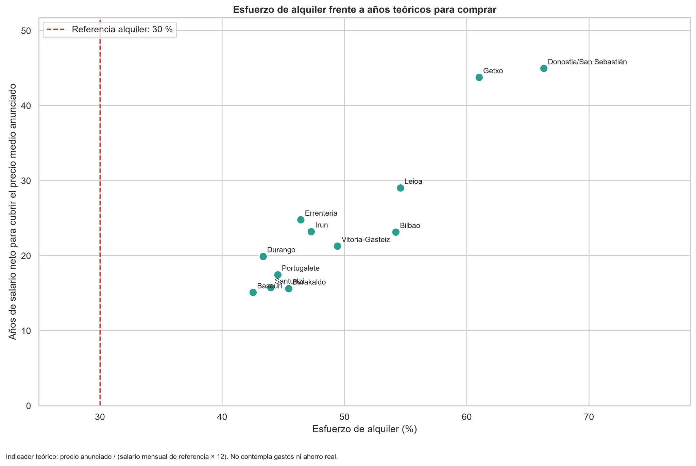
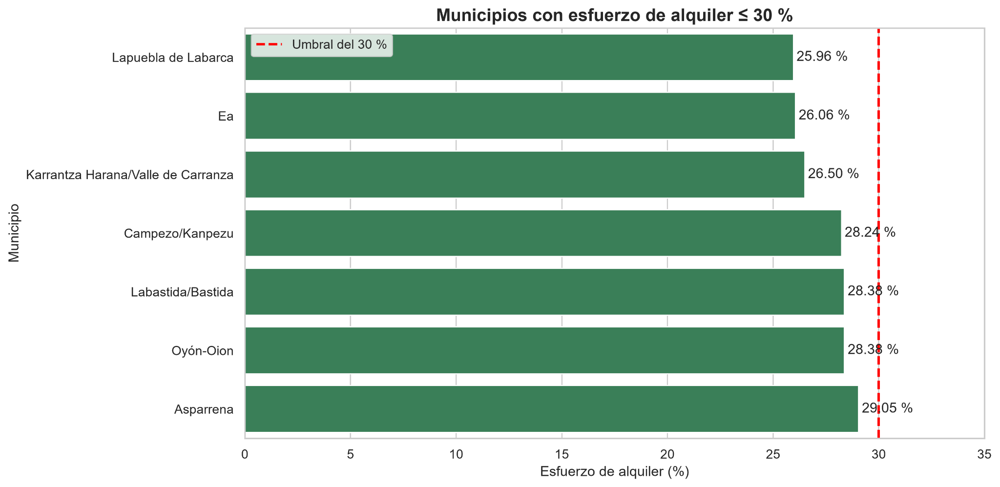

# ¿Dónde pueden vivir los jóvenes en Euskadi?

**Euskadi Vivienda Big Data** · Proyecto intermodular de Big Data Aplicado (BDA) y Sistemas de Big Data (SBD) · Curso de Especialización en Inteligencia Artificial y Big Data.

> **Pregunta de investigación:** ¿Puede una persona joven independizarse en Euskadi con su salario?

El proyecto analiza el acceso económico al alquiler y a la compraventa de vivienda mediante fuentes oficiales, anuncios inmobiliarios y salarios juveniles de referencia. El catálogo territorial incluye los **252 municipios de Euskadi**, aunque la disponibilidad de indicadores varía según la fuente.

## Índice

1. [Presentación del proyecto](#1-presentación-del-proyecto)
2. [Objetivos y tecnologías](#2-objetivos-y-tecnologías)
3. [Arquitectura general](#3-arquitectura-general)
4. [Estructura de carpetas](#4-estructura-de-carpetas)
5. [Obtención de datos](#5-obtención-de-datos)
6. [Kafka y HDFS](#6-kafka-y-hdfs)
7. [MongoDB y PyMongo](#7-mongodb-y-pymongo)
8. [Instalación y ejecución](#8-instalación-y-ejecución)
9. [Resultados, gráficos y conclusiones](#9-resultados-gráficos-y-conclusiones)
10. [Evidencias y limitaciones](#10-evidencias-y-limitaciones)

## 1. Presentación del proyecto

El reto busca responder **dónde resulta más viable vivir para una persona joven en Euskadi**, comparando la carga del alquiler y el coste teórico de compra respecto a un salario neto de referencia. Se estudian diferencias municipales y provinciales, distinguiendo entre cobertura territorial del catálogo y disponibilidad efectiva de cada dato.

## 2. Objetivos y tecnologías

### Objetivos

- Recopilar datos reales mediante API, web scraping y fuentes oficiales.
- Almacenar archivos originales en HDFS.
- Trabajar con Apache Kafka para simular la llegada de anuncios inmobiliarios.
- Limpiar, normalizar e integrar datos heterogéneos mediante Python y Pandas.
- Almacenar y consultar información mediante MongoDB y PyMongo.
- Calcular indicadores de accesibilidad económica a la vivienda.
- Comparar municipios y provincias de Euskadi.
- Automatizar el procesamiento y el análisis.
- Generar tablas, gráficos y conclusiones basadas en datos.

### Tecnologías

- **Python:** desarrollo de scripts y automatización.
- **Pandas y NumPy:** limpieza, transformación e integración de datos.
- **Requests y BeautifulSoup:** extracción mediante API y web scraping.
- **Apache Hadoop (HDFS):** almacenamiento de datos originales.
- **Apache Kafka:** transmisión y simulación de eventos.
- **MongoDB:** almacenamiento documental.
- **PyMongo:** consultas, agregaciones y preparación de resultados.
- **Matplotlib:** visualización de indicadores.
- **Pytest:** pruebas del proyecto.

Se emplea también **Tableau Public** para la visualización interactiva de resultados.

## 3. Arquitectura general



La arquitectura parte de la extracción mediante APIs, scraping y fuentes oficiales, seguida de limpieza, normalización e integración con Python. Desde ahí se distinguen **dos ramas complementarias**:

- **Consulta y análisis:** datos preparados en MongoDB, importación de colecciones, operaciones con PyMongo, agregaciones y gráficos con Matplotlib.
- **Transmisión y conservación:** productores y consumidores de Kafka, transporte de archivos y almacenamiento de **originales (`raw`) en HDFS**, con comprobaciones de integridad.

El diagrama es conceptual: su lista de colecciones no representa exactamente las cinco colecciones reales; estas se detallan en el apartado 7.

## 4. Estructura de carpetas

```text
EUSKADI_VIVIENDA_BIGDATA/
├── config/
├── data/
│   ├── raw/
│   ├── processed/
│   ├── mongodb/
│   ├── hdfs_verificacion/
│   └── tmp_kafka_hdfs/
├── scripts/
│   ├── extraccion/
│   ├── procesamiento/
│   ├── hdfs/
│   ├── kafka/
│   ├── mongodb/
│   ├── analisis/
│   └── main.py
├── resultados/
│   ├── graficos/
│   ├── historico/
│   ├── imagenes/
│   ├── indicadores/
│   └── RA1_RA3_Jon/
├── docs/
│   └── imagenes/             # Diagramas y gráficos incluidos en este README
├── tests/
├── videos/
├── backup_mongodb/
├── requirements.txt
└── README.md
```

**Función de los directorios:** `data/raw` conserva entradas originales; `data/processed` almacena tablas transformadas; `data/mongodb` contiene JSON preparados para la importación; `scripts/extraccion`, `scripts/procesamiento`, `scripts/kafka`, `scripts/hdfs` y `scripts/mongodb` agrupan tareas por etapa; `scripts/main.py` orquesta las fases; `resultados/graficos` contiene salidas visuales; `resultados/historico` conserva auditorías y registros; `docs/imagenes` aloja las imágenes visibles en GitHub; `tests` incluye pruebas; `videos` está reservado a evidencias audiovisuales; `backup_mongodb` contiene copias de respaldo cuando se generan.

## 5. Obtención de datos

### Fuentes utilizadas

- Eustat.
- Instituto Nacional de Estadística (INE).
- Observatorio Vasco de la Vivienda.
- Observatorio del Alquiler.
- Observatorio Vasco de la Juventud.
- Pisos.com.
- Estadísticas registrales inmobiliarias.

Las fuentes presentan distintas estructuras, coberturas territoriales y periodos de referencia. Estas diferencias se tienen en cuenta durante el procesamiento y la interpretación de resultados.

### Métodos de obtención

- **Scraping de Pisos.com:** extracción de anuncios inmobiliarios de los municipios cubiertos, con precios y características de los inmuebles. La colección de anuncios analizada reúne 2.952 documentos de 12 municipios; no debe confundirse con cobertura inmobiliaria de los 252 municipios.
- **INE:** datos estadísticos y de precios de compraventa usados en el procesamiento municipal. La disponibilidad se limita a los municipios publicados por la fuente.
- **Eustat:** información estadística y de alquiler empleada en los indicadores municipales; el proyecto combina consulta web, archivos oficiales y los mecanismos de extracción disponibles.
- **Otras fuentes:** Observatorio del Alquiler (API de series provinciales), Observatorio Vasco de la Vivienda, Observatorio Vasco de la Juventud y estadísticas registrales inmobiliarias.

La extracción por API y el scraping no deben confundirse con la descarga de CSV/XLSX oficiales. El README describe los mecanismos utilizados en el proyecto sin afirmar que **todos** los datos de INE o Eustat procedan exclusivamente de una API.

## 6. Kafka y HDFS

### Flujo de transmisión

Los **productores Kafka** publican eventos o fragmentos de archivos; los **consumidores** los reciben y los procesan. La integración con HDFS permite conservar archivos originales, de acuerdo con el alcance del proyecto: **no es obligatorio guardar los procesados en HDFS**.

### Comprobaciones realizadas

- Prueba productor-consumidor: **10 de 10 anuncios recibidos**.
- Integración **Kafka → HDFS** verificada.
- Transmisión de **41 de 41 archivos originales** mediante **212 fragmentos**.
- Comprobación de integridad de archivos mediante **SHA-256**, además de pruebas de acceso y recuperación desde HDFS.

Estas cifras corresponden a las pruebas documentadas del proyecto; no significan que Kafka sea la única vía de importación a MongoDB.

## 7. MongoDB y PyMongo

### Modelo documental



> **Nota sobre la imagen:** el esquema es ilustrativo y contiene discrepancias con la base real. `mercado_alquiler` tiene **3 documentos**, no 1; `salarios` y `economia_juvenil` están organizados por dimensiones, categorías e indicadores, no necesariamente por municipio. La estructura efectiva se verifica con `revisar_colecciones.py`.

### Colecciones verificadas

| Colección real | Documentos | Contenido |
|---|---:|---|
| `municipios` | 252 | Catálogo municipal e indicadores integrados |
| `anuncios` | 2.952 | Anuncios de compraventa, características y campos de limpieza |
| `mercado_alquiler` | 3 | Series trimestrales provinciales, 33 registros en total |
| `salarios` | 120 | Salarios juveniles por dimensión y categoría |
| `economia_juvenil` | 148 | Indicadores económicos de juventud |
| **Total** | **3.475** | **Cinco colecciones principales** |

La auditoría verificó **2.952 referencias válidas** desde anuncios a municipios, sin referencias inexistentes. En la limpieza quedaron **168 zonas normalizadas como no especificadas**, **70 anuncios marcados para revisión de posibles duplicados**, **2.906 precios/m² calculados** y **46 no disponibles**. Los duplicados marcados no se eliminan automáticamente.

### Importación, validación y limpieza

La fase `mongodb` trabaja **exclusivamente con `EUSKADI_VIVIENDA_BIGDATA_TEST`** y se ejecutó correctamente el **12/11/2026**:

1. Comprueba recuentos existentes y valida el JSON de los 252 municipios.
2. Ejecuta `validar_municipios.py` y los cinco importadores: `importar_municipios.py`, `importar_anuncios.py`, `importar_alquiler.py`, `importar_salarios.py` e `importar_economia.py`.
3. Audita estructura y referencias con `revisar_colecciones.py`.
4. Limpia y normaliza anuncios mediante `limpiar_datos.py`.
5. Verifica recuentos y el campo `limpieza`, y ejecuta `consultas_ra3.py`.

**Resultados:** 252 códigos INE únicos, 0 códigos inválidos, 0 esfuerzos incoherentes y **2.952 referencias válidas** de anuncios a municipios. La limpieza marcó **168 zonas sin especificar**, **70 posibles duplicados para revisión**, **2.906 precios/m² calculados** y **46 no disponibles**. Los duplicados no se eliminan automáticamente. La ejecución repetida no produjo cambios en los documentos ya cargados.

### Consultas, índices y agregaciones

Se incluyen scripts específicos como `consultas_ra3.py`, `indices_ra3.py` y los pipelines `pipeline_01_esfuerzo_provincias.py`, `pipeline_02_compraventa_municipios.py` y `pipeline_03_alquiler_compraventa.py`. Las consultas verificadas incluyen viviendas de hasta 200.000 €, características de inmuebles, anuncios por municipio, presión de alquiler e indicadores juveniles. **La existencia del script de índices no implica que la ejecución de `main.py --fase mongodb` los cree automáticamente**: ese paso no forma parte de la fase probada.

## 8. Instalación y ejecución

### Requisitos

- Python y entorno Conda `big_data`.
- MongoDB local disponible en `mongodb://localhost:27017/` para la fase `mongodb`.
- Servicios Kafka/HDFS disponibles cuando se ejecuten sus flujos específicos.
- Dependencias declaradas en `requirements.txt`.

```cmd
conda activate big_data
python -m pip install -r requirements.txt
```

### Orden de ejecución de las fases del orquestador

**1. Procesamiento** (ocho scripts, generación de datos e indicadores):

```cmd
python scripts/main.py --fase procesamiento
```

**2. MongoDB TEST** (importación, auditoría, limpieza y consultas):

```cmd
python scripts/main.py --fase mongodb
```

**3. Análisis** (cinco procesos, tabla y cuatro gráficos):

```cmd
python scripts/main.py --fase analisis
```

**Importante:** el orden anterior explica el flujo lógico, pero la fase MongoDB TEST **exige que las cinco colecciones ya tengan los recuentos esperados antes de importar**; no es un procedimiento de inicialización de una base vacía. La fase de análisis utiliza su propia configuración de conexión, que debe verificarse antes de ejecutarla. Kafka/HDFS se gestionan mediante sus scripts específicos, no mediante estas tres opciones de `main.py`.

### Pruebas

```cmd
python -m pytest tests/ -v
```

**Resultado verificado el 09/11/2026:** 9 pruebas superadas, 0 fallos (Python 3.12.14, pytest 9.2.0). Se comprueba la unicidad de códigos INE, las columnas obligatorias, la coherencia del esfuerzo de alquiler, la cobertura y positividad de precios y la presencia de indicadores de años de salario. Estas pruebas no sustituyen las verificaciones de Kafka, HDFS o MongoDB.

### Automatización verificada

| Fase | Procesos | Estado | Tiempo registrado |
|---|---|---|---:|
| Procesamiento | 8 scripts | Correcto | 5,75 s |
| MongoDB (TEST) | 5 importadores + validación, auditoría, limpieza y consultas | Correcto | 7,74 s |
| Análisis | 5 procesos | Correcto | 7,76 s |

La segunda ejecución de MongoDB se guardó en `resultados/historico/ejecucion_mongodb_20261112.txt`. Los tiempos dependen del equipo y del estado de los servicios.

## 9. Resultados, gráficos y conclusiones

### Indicadores de accesibilidad

Ejecución verificada el 9 de noviembre de 2026.

| Indicador | Resultado |
|---|---:|
| Municipios integrados | 252 |
| Municipios con alquiler Eustat | 159 |
| Municipios con alquiler EMAL | 73 |
| Municipios con algún indicador de compraventa | 31 |
| Municipios con alquiler y compraventa | 31 |
| Municipios con esfuerzo de alquiler superior al 30 % | 152 |
| Municipios con esfuerzo igual o inferior al 30 % | 7 |

La tabla analítica final contiene **252 municipios y 16 columnas**, con códigos INE únicos y sin duplicados.

Archivo generado:

`data/processed/indicadores_vivienda_juvenil_euskadi.csv`

Los principales indicadores trabajados son:

1. Renta mensual media de alquiler.
2. Salario neto mensual de referencia.
3. Porcentaje del salario destinado al alquiler.
4. Precio medio de compraventa.
5. Años teóricos de salario necesarios para adquirir una vivienda.

El esfuerzo de alquiler se calcula como:

**Esfuerzo (%) = (Alquiler mensual / Salario neto mensual) × 100**

Los años teóricos de salario para la compra se calculan dividiendo el precio de vivienda entre el salario neto anual de referencia, sin descontar gastos de vida, impuestos ni financiación.

### Gráficos del análisis

#### Esfuerzo medio de alquiler por provincia



En los municipios con indicador disponible, el esfuerzo medio representado supera el 30 % en las tres provincias: Bizkaia **40,52 %** (74 municipios), Gipuzkoa **40,48 %** (65) y Araba/Álava **34,44 %** (20). Las medias corresponden a la cobertura del gráfico, no a la totalidad de municipios de cada provincia.

#### Precio medio anunciado de compraventa por municipio



La muestra de anuncios presenta los precios medios de oferta más altos en Donostia/San Sebastián (**839.161 €**) y Getxo (**832.630 €**). Son **precios anunciados**, no importes de compraventas cerradas; las muestras municipales tienen tamaños diferentes.

#### Esfuerzo de alquiler frente a años teóricos de salario para comprar



Este gráfico compara, para los municipios representados, el porcentaje del salario de referencia dedicado al alquiler y los años teóricos necesarios para cubrir el precio anunciado de compra. No incorpora gastos de manutención, impuestos ni condiciones hipotecarias.

#### Municipios con esfuerzo de alquiler igual o inferior al 30 %



Los siete municipios representados están por debajo del umbral de referencia del 30 %. El indicador utiliza el salario de referencia y la cobertura disponible, por lo que no equivale a una garantía individual de asequibilidad.

### Comparativa de municipios

| Municipio | Alquiler mensual | Esfuerzo |
|---|---:|---:|
| Donostia/San Sebastián | 1.031 € | 66,30 % |
| Getxo | 967 € | 61,01 % |
| Bilbao | 859 € | 54,20 % |
| Vitoria-Gasteiz | 735 € | 49,43 % |
| Barakaldo | 720 € | 45,43 % |
| Basauri | 674 € | 42,52 % |

Entre los 159 municipios con datos suficientes para calcular el esfuerzo de alquiler, **152 (95,6 %) superan el umbral de referencia del 30 %**.

### Conclusiones

- El esfuerzo medio provincial mostrado en los municipios con información disponible supera el **30 %** en Bizkaia (40,52 %), Gipuzkoa (40,48 %) y Araba/Álava (34,44 %).
- Entre los **159 municipios con esfuerzo calculable**, **152 (95,6 %)** superan el 30 %; los otros siete se muestran en el gráfico de municipios con menor esfuerzo.
- Los anuncios de compraventa reflejan diferencias municipales significativas, pero sus precios son **de oferta**, no de transacción.
- El indicador de años de salario es una comparación teórica, no un cálculo de viabilidad hipotecaria individual.

### Dashboard interactivo

[**Abrir el dashboard de Euskadi Vivienda en Tableau Public**](https://public.tableau.com/app/profile/jon.ander.gorricho.herrero/viz/Vivienda_Euskadi_Dashboard/Dashboard1?publish=yes)

## 10. Evidencias y limitaciones

### Evidencias y registros

- **MongoDB:** `resultados/historico/ejecucion_mongodb_20261112.txt` (ejecución TEST verificada), y `resultados/historico/auditoria_colecciones.txt` (auditoría anterior).
- **Calidad del ETL:** `resultados/historico/informe_calidad_etl.md`.
- **Gráficos:** `resultados/graficos/` (originales) y `docs/imagenes/` (copias integradas en este README).
- **Pruebas:** `tests/test_indicadores.py`, con nueve pruebas superadas.
- **Kafka/HDFS:** registros, comprobaciones de transmisión e integridad descritos en el apartado 6; su ubicación final debe contrastarse con los archivos entregados.
- **Vídeos:** carpeta `videos/`, destinada a evidencias audiovisuales; no se presupone que contenga grabaciones sin verificarlo.
- **Tableau:** enlace público incluido en el apartado 9.

### Limitaciones

- Aunque se incluyen los 252 municipios, no todos disponen de indicadores completos.
- El alquiler cuenta con mayor cobertura municipal que la compraventa.
- Se utilizan salarios juveniles provinciales de referencia, no ingresos individuales de cada municipio.
- Las fuentes pueden corresponder a distintos años.
- Los precios de oferta inmobiliaria no equivalen necesariamente a precios finales de transacción.
- Los años teóricos de salario para comprar no representan una estimación completa de viabilidad hipotecaria.
- Las conclusiones deben interpretarse según la cobertura y metodología de cada fuente.
- Los diagramas arquitectónicos y documentales son ilustrativos; el esquema y los recuentos reales de MongoDB se verifican mediante los scripts y registros.
- La fase MongoDB se ha probado con colecciones TEST ya pobladas; no equivale a una prueba de carga inicial desde una base vacía.

